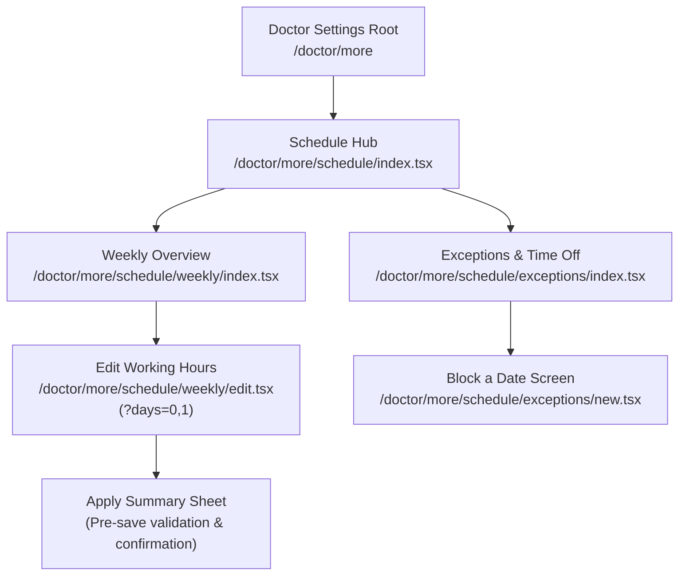
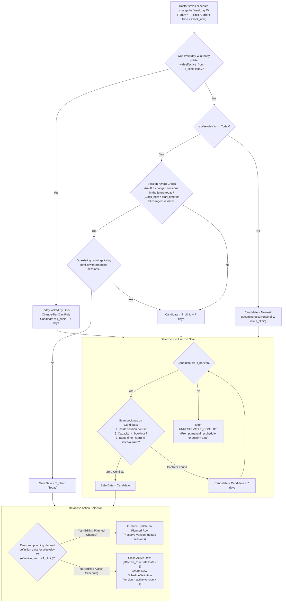
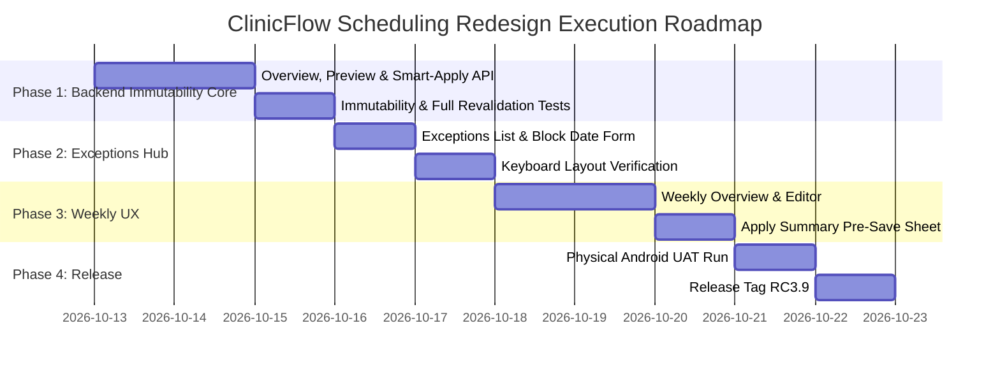

# ClinicFlow Scheduling Redesign Specification
**Document Version:** 1.2.1
**Target Release:** RC3.9 / M13
**Status:** Approved Architecture Specification
**Supersedes:** Version 1.2.0, Version 1.1.0 & Version 1.0.0-PROPOSAL

---

## 1. Executive Summary & Historical Schedule Immutability

### 1.1 The Historical Immutability Invariant
A foundational flaw in earlier scheduling implementations was mutating an already-effective [`ScheduleDefinition`](file:///E:/ClinicFlow/clinicflow/backend/app/modules/scheduling/models.py#L25) row in-place whenever a schedule edit occurred on the current date. Doing so rewrote clinical history: an edit made at 14:00 to a schedule effective since 09:00 or 1 Oct made it appear as though the new hours had been active for the entire duration, corrupting audit trails and misrepresenting the operational rules under which prior patient appointments were booked.

In Version 1.2.1, the core invariant is absolute:

> [!IMPORTANT]
> **Core Invariant: Historical Schedule Immutability**
> Once a `ScheduleDefinition` has become effective (`effective_from <= T_clinic`), its operational definition is **permanently immutable**.
> Its session definitions, hours, capacities, and slot intervals must **never** be mutated in place.
> Any modification to active clinic hours **always closes the active definition** (`effective_to = new_effective_date - 1 day`) and **creates a new `ScheduleDefinition`** (`effective_from = new_effective_date`, `version = prior_business_version + 1`). This invariant applies without exception.

### 1.2 The One-Change-Per-Day Rule (Resolving Same-Day Re-Edits)
A doctor may have at most **ONE** newly-effective recurring schedule change for a given weekday on any single clinic date:
- If a schedule change is applied today ($T_{clinic}$), creating a new definition effective today, **that definition is immediately effective and therefore permanently immutable**.
- If the doctor edits that weekday again later on the same day:
  - The definition created earlier today is **NOT** mutated in-place.
  - A duplicate version with the same `effective_from` is **NOT** created (preventing database unique constraint collisions on `(doctor_id, weekday, effective_from)`).
  - The second edit **automatically defers to the next safe weekday occurrence** ($T_{clinic} + 7\text{ days}$).
  - UI Notice: *"Today's working hours were already updated. This additional change will apply from Monday, {next_occurrence_date}."*

### 1.3 Allowed In-Place Edits
In-place modification of a `ScheduleDefinition` and its child [`SessionDefinition`](file:///E:/ClinicFlow/clinicflow/backend/app/modules/scheduling/models.py#L57) rows is strictly restricted to narrow, non-historical conditions:

1. **Future Planned Definition That Has NOT Yet Become Effective (`effective_from > T_clinic`)**:
   - May be updated or replaced in-place until the clinic date reaches `effective_from`.
   - *Rationale*: A planned future version has not yet governed active clinic operations or historical attendance. Allowing in-place edits prevents redundant version inflation (e.g. creating Version 3, 4, 5 for edits made prior to activation).
2. **Newly Created Unsaved / Preview State**:
   - In-flight client drafts and server simulation previews are freely editable prior to transactional commitment.
3. **Already-Effective Definition (`effective_from <= T_clinic`)**:
   - **Strictly Immutable**. Any change creates a new business version row, effective either today (if no change was yet made today) or on a future date.

---

## 2. The Doctor-Centric Mental Model

### 2.1 Core Paradigm Shift
The scheduling system shifts from **"Manage Versioned Schedule Definitions"** to **"My Practice Hours & Time Off"**:

| Dimension | Old Primitives (Exposed DB) | New Primitives (Doctor Mental Model) |
| :--- | :--- | :--- |
| **Weekly Pattern** | `ScheduleDefinition` (weekday, effective_from, version) | **Standard Weekly Hours** (Monday, Tuesday, etc.) |
| **Effective Date** | Manual date picker (`effective_from`) | **Automatic Application Date** (*"Applies from 19 Oct"* or *"Applies Today"*) |
| **Upcoming Plans** | Hidden in subsequent DB version rows | **Upcoming Planned Changes** (*"Current: 10–1; From 19 Oct: 11–2"*) |
| **Conflicts** | HTTP 409 Conflict with timestamp errors | **Apply Summary & Conflict Resolver** (*"Applies from 22 Oct due to 2 existing bookings"*) |
| **Ad-hoc Closures** | Monolithic bottom form with session IDs | **Dedicated Exceptions & Time-Off Hub** (*"Block a Date"*) |
| **Database Version** | Surfaced in UI (*"Version 2"*) | **Hidden Invariant** (Retained purely for internal audit, history, and FK integrity) |

### 2.2 Guiding Tenets
1. **Zero Raw Version UI**: Doctors never see version numbers, `effective_from` date pickers, or raw database timestamps during regular scheduling.
2. **Deterministic Safe Application**: The engine automatically computes the earliest safe date on which a schedule modification can take effect without orphaning or conflicting with existing patient bookings.
3. **Session-Aware Same-Day Evaluation**: Same-day application is evaluated per affected session. Changing an unstarted Evening session does not freeze merely because the Morning session has finished.
4. **Transparent "Why" Explanations**: When a change is deferred, the system explicitly communicates the reason in an **Apply Summary** card before saving.
5. **Non-Destructive Date Exceptions**: Blocking a date prevents new bookings while preserving existing appointments intact, warning staff of remaining bookings.
6. **Isolated Purpose-Built Screens**: Text-entry workflows live in compact screens where inputs sit high on the viewport, eliminating keyboard obstruction structurally.

---

## 3. Frozen Route & Screen Structure

The scheduling architecture is divided into a dedicated route tree under `mobile/app/doctor/more/schedule/`:

```
mobile/app/doctor/more/schedule/
├── _layout.tsx                     # Stack layout (headerShown: false, screen transitions)
├── index.tsx                       # Schedule Hub (Weekly summary + Exceptions card)
├── weekly/
│   ├── index.tsx                   # Weekly Schedule Overview (All 7 days + upcoming plans)
│   └── edit.tsx                    # Weekly Hours Editor (Day chips, sessions, Apply Summary)
└── exceptions/
    ├── index.tsx                   # Exceptions Hub (Upcoming blocked dates list + Unblock)
    └── new.tsx                     # Dedicated "Block a Date" Form (Compact, top-aligned)
```

### 3.1 Route Topology Diagram



### 3.2 Screen Responsibilities
- **Schedule Hub (`schedule/index.tsx`)**:
  - Top: Back control, Title: *"Schedule & Sessions"*.
  - Section 1: **Standard Weekly Hours** card showing current practice days, session times, and prominent *"Edit Weekly Hours"* button. If an upcoming schedule change is planned, an *"Upcoming Change"* banner is displayed directly below that day.
  - Section 2: **Exceptions & Time Off** card showing count of upcoming blocked dates, next 2 exceptions, and buttons: `"+ Block a Date"` and `"View All Exceptions"`.
- **Weekly Schedule Overview (`schedule/weekly/index.tsx`)**: Full 7-day breakdown with current and pending future hours.
- **Weekly Hours Editor (`schedule/weekly/edit.tsx`)**: Day chips, session cards, Day-Off toggle, and *"Review & Apply Hours"* button triggering the Apply Summary.
- **Exceptions Hub (`schedule/exceptions/index.tsx`)**: Chronological list of active upcoming blocked dates, retained booking counts, and unblock controls.
- **Block a Date Screen (`schedule/exceptions/new.tsx`)**: Short form. **Reason field sits at $Y \approx 200\text{px}$, naturally well above virtual keyboard**. Non-destructive appointment warning banner.

---

## 4. Business Versioning & Lifecycle Semantics

### 4.1 Strict Business Version Sequence
`ScheduleDefinition.version` represents the **chronological sequence of operational working hours** for a given doctor and weekday.

```text
LIFECYCLE TIMELINE EXAMPLE (Monday):

1. Initial Schedule Creation (1 Oct 2026):
   ├── ScheduleDefinition A: version=1, effective_from=2026-10-01, effective_to=NULL
   └── Hours: 10:00–13:00

2. First Edit on 12 Oct 2026 at 09:00 (Safe Date = Today 12 Oct, hours changed to 11:00–14:00):
   ├── ScheduleDefinition A closed: effective_to=2026-10-11 (Immutable history!)
   ├── ScheduleDefinition B created: version=2, effective_from=2026-10-12, effective_to=NULL
   └── Hours: 11:00–14:00 (Active immediately today)

3. Second Edit on 12 Oct 2026 at 09:20 (Doctor wants 11:30–14:30):
   ├── ScheduleDefinition B was activated today -> PERMANENTLY IMMUTABLE!
   ├── No duplicate effective_from=2026-10-12 row allowed.
   ├── Next safe candidate calculated -> Monday, 19 Oct 2026.
   ├── ScheduleDefinition B clipped: effective_to=2026-10-18.
   ├── ScheduleDefinition C created: version=3, effective_from=2026-10-19, effective_to=NULL.
   └── Hours: 11:30–14:30 (Applies from next week)

4. Re-edit on 14 Oct 2026 of Planned Change (Doctor adjusts 19 Oct plan to 12:00–15:00):
   ├── ScheduleDefinition C is NOT YET EFFECTIVE (effective_from 19 Oct > today 14 Oct).
   ├── ScheduleDefinition C is updated IN PLACE (version remains 3, sessions updated).
   └── NO redundant Version 4 row is created!
```

---

## 5. Session Occurrence & Appointment Preservation

### 5.1 Invariants for [`SessionOccurrence`](file:///E:/ClinicFlow/clinicflow/backend/app/modules/scheduling/models.py#L90)
1. **Historical Occurrences are Immutable**: Occurrences with `occurrence_date < new_effective_date` are permanently immutable. They retain snapshots of the original `SessionDefinition`.
2. **Existing Appointments Remain Anchored**: Every [`Appointment`](file:///E:/ClinicFlow/clinicflow/backend/app/modules/appointments/models.py#L23) points to its `session_occurrence_id`. Even when a new weekly schedule version is activated, existing appointment rows retain their exact occurrence foreign keys, times, and financial snapshots.
3. **Future Materialized Occurrences ($\ge \text{new\_effective\_date}$)**:
   - **If Bookings or Blocks Exist**: The occurrence **must not be deleted or overwritten**. The safe-date algorithm guarantees that new versions only take effect on dates where existing occurrences are 100% compatible or unmaterialized.
   - **If 0 Bookings and Status is AVAILABLE**: If an unbooked, unblocked occurrence was pre-materialized, it may be refreshed with the new session definition's snapshots (`start_time_snapshot`, `end_time_snapshot`, `slot_interval_minutes_snapshot`, `maximum_capacity_snapshot`).

---

## 6. Non-Destructive Date Exceptions (Freezing V1 Rules)

1. **Blocking Prevents New Bookings**: When a date or session is blocked, new appointments cannot be created for that occurrence.
2. **Existing Appointments are NEVER Automatically Cancelled or Invalidated**:
   - Existing booked appointments remain **valid**, **visible**, and **untouched**.
   - The system never deletes or reschedules patients automatically without clinical human review.
3. **Transparent Warning in UI**:
   - The UI displays an informational badge: *"Date blocked. Notice: {count} patients are booked on this date. Please reschedule or cancel manually if required."*
4. **No Hard-Block on Exception Creation**: The presence of existing appointments does **NOT** prevent the doctor from blocking the date for future bookings.

---

## 7. Automatic Application-Date Algorithm

### 7.1 Algorithm Flowchart



### 7.2 Session-Aware Same-Day Feasibility
When editing today's weekday ($W == T_{clinic}.\text{weekday}$):
1. **One-Change-Per-Day Check**: If an active schedule row already has `effective_from == T_clinic`, today is locked against further modification; candidate advances to $T_{clinic} + 7\text{ days}$.
2. **Identify Affected Sessions**:
   - Compare proposed session set $\{S_{new}\}$ with active session set $\{S_{old}\}$.
   - A session is **Affected** if added, removed, or modified in timing/capacity.
3. **Evaluate Same-Day Feasibility**:
   - Modified session: require $Clock_{now} < S_{old}.\text{start\_time}$ AND $Clock_{now} < S_{new}.\text{start\_time}$.
   - Added session: require $Clock_{now} < S_{new}.\text{start\_time}$.
   - Removed session: require $Clock_{now} < S_{old}.\text{start\_time}$ AND 0 bookings in $S_{old}$ today.
4. **Outcome**:
   - If **ALL** affected sessions satisfy these conditions and 0 appointment conflicts exist today $\rightarrow$ Safe Date is **Today ($T_{clinic}$)**.
   - If **ANY** affected session has started or completed today $\rightarrow$ Safe Date advances to **Next Week ($T_{clinic} + 7\text{ days}$)**.

### 7.3 Configured Safe-Date Horizon
The search boundary $D_{horizon}$ is determined by the clinic's configured booking horizon:

$$D_{horizon} = \max(D_{configured\_horizon\_end}, D_{latest\_active\_booking} + 7\text{ days})$$

- If no clinic horizon setting is configured, default to $T_{clinic} + 30\text{ days}$.
- If every candidate occurrence up to $D_{horizon}$ has conflicting bookings, the engine stops search and returns `UNRESOLVABLE_APPOINTMENT_CONFLICT`.

---

## 8. Appointment Conflict Rules & Strict Slot Modulo

An existing appointment $A$ at time $t_{appt}$ (minutes from midnight) on date $D$ in session $S_{old}$ conflicts with proposed session $S_{new}$ ($[t_{start}, t_{end}]$, interval $I_{slot}$, capacity $C$) if ANY condition holds:

1. **Boundary Violation**: $t_{appt} < t_{start}$ OR $t_{appt} \ge t_{end}$.
2. **Capacity Deficit**: Total active appointments in $S_{new}$ on date $D > C$.
3. **Strict Slot-Grid Misalignment**:
   $$(t_{appt} - t_{start}) \pmod{I_{slot}} \ne 0$$
   *Strict V1 Rule: Zero fractional or offset slot tolerances.*
4. **Session Deletion**: $S_{old}$ was deleted, but active appointments remain in it on date $D$.

---

## 9. Proposal Token Security & Authoritative Smart-Apply Transaction

### 9.1 Server-Signed Proposal Token (Advisory Preview)
`POST preview-impact` generates a cryptographically server-signed (HMAC-SHA256) `proposal_token` with a 10-minute expiry. The preview response is **strictly advisory**.

**Token Claims:**
```json
{
  "clinic_id": "019485c2-1234-789a-bcde-000000000001",
  "doctor_id": "019485c2-1234-789a-bcde-000000000002",
  "payload_hash": "e3b0c44298fc1c149afbf4c8996fb92427ae41e4649b934ca495991b7852b855",
  "weekdays": [0, 3],
  "expected_states": {
    "0": {
      "active_id": "019485c2-1234-789a-bcde-000000000010",
      "active_version": 1,
      "upcoming_id": null,
      "upcoming_version": null,
      "calculated_safe_date": "2026-10-19"
    },
    "3": {
      "active_id": "019485c2-1234-789a-bcde-000000000030",
      "active_version": 1,
      "upcoming_id": null,
      "upcoming_version": null,
      "calculated_safe_date": "2026-10-22"
    }
  },
  "evaluated_at": "2026-10-12T14:30:00Z",
  "exp": 1728744000
}
```

### 9.2 Authoritative 10-Step Smart-Apply Transaction
During `PUT smart-apply`, the final transaction executes the authoritative business logic:

```mermaid
sequenceDiagram
    autonumber
    actor Client as Mobile Client
    participant API as Smart-Apply Endpoint
    participant DB as PostgreSQL 17

    Client->>API: PUT /schedule/smart-apply (proposal, proposal_token)
    activate API
    API->>API: 1. Verify HMAC signature and token expiration
    API->>API: 2. Verify clinic_id and doctor_id
    API->>API: 3. Verify SHA-256 payload_hash matches submitted body

    API->>DB: BEGIN TRANSACTION
    API->>DB: 4. SELECT ... FOR UPDATE on target active & upcoming ScheduleDefinitions
    API->>API: 5. Verify locked row IDs and versions match token expected_states
    API->>DB: 6. Rerun complete appointment & exception conflict analysis against live DB
    API->>API: 7. Recompute safe effective dates for each weekday
    API->>API: 8. Compare computed effective dates with token's calculated_safe_date

    alt State Mismatch or Timeline Divergence
        API->>DB: 9. ROLLBACK TRANSACTION
        API-->>Client: HTTP 409 STALE_SCHEDULE_PREVIEW
        Client-->>Client: Re-fetches preview automatically; displays updated timeline
    else State Matches Preview Exactly
        API->>DB: 10. Execute updates: close active (effective_to = safe-1), insert new version (or update planned in-place)
        API->>DB: COMMIT TRANSACTION
        API-->>Client: HTTP 200 OK: Updated Weekly Overview
    end
    deactivate API
```

---

## 10. Backend API Redesign

### 10.1 `GET /api/v1/doctors/{doctor_id}/schedule/overview`
Returns current hours and pending upcoming changes for all 7 days.

**Response (200 OK):**
```json
{
  "doctor_id": "019485c2-1234-789a-bcde-000000000002",
  "effective_on": "2026-10-12",
  "days": [
    {
      "weekday": 0,
      "weekday_name": "Monday",
      "current": {
        "schedule_definition_id": "019485c2-1234-789a-bcde-000000000010",
        "effective_from": "2026-10-01",
        "effective_to": null,
        "version": 1,
        "sessions": [
          {
            "session_name": "Morning",
            "start_time": "10:00:00",
            "end_time": "13:00:00",
            "slot_interval_minutes": 15,
            "maximum_capacity": 10
          }
        ]
      },
      "upcoming": {
        "schedule_definition_id": "019485c2-1234-789a-bcde-000000000020",
        "effective_from": "2026-10-19",
        "effective_to": null,
        "version": 2,
        "sessions": [
          {
            "session_name": "Morning",
            "start_time": "11:00:00",
            "end_time": "14:00:00",
            "slot_interval_minutes": 15,
            "maximum_capacity": 10
          }
        ]
      }
    }
  ]
}
```

### 10.2 `POST /api/v1/doctors/{doctor_id}/schedule/preview-impact`
Generates the server-signed `proposal_token` and per-day timeline.

**Request:**
```json
{
  "weekdays": [0, 3],
  "sessions": [
    {
      "session_name": "Morning",
      "start_time": "11:00:00",
      "end_time": "13:00:00",
      "slot_interval_minutes": 15,
      "maximum_capacity": 8,
      "active": true,
      "display_order": 0
    }
  ]
}
```

**Response (200 OK):**
```json
{
  "proposal_token": "eyJhbGciOiJIUzI1NiIsInR5cCI6IkpXVCJ9...",
  "evaluated_at": "2026-10-12T14:30:00Z",
  "impacts": [
    {
      "weekday": 0,
      "weekday_name": "Monday",
      "applies_from": "2026-10-19",
      "reason": "Today's clinic hours have already started.",
      "existing_appointments_count": 0,
      "conflict_detected": false
    },
    {
      "weekday": 3,
      "weekday_name": "Thursday",
      "applies_from": "2026-10-22",
      "reason": "2 existing appointments booked on 15 Oct fall outside proposed hours (10:00 - 10:30 AM).",
      "existing_appointments_count": 2,
      "conflict_detected": true
    }
  ]
}
```

### 10.3 `PUT /api/v1/doctors/{doctor_id}/schedule/smart-apply`
Executes atomic schedule updates under row lock and token verification.

**Request:**
```json
{
  "proposal_token": "eyJhbGciOiJIUzI1NiIsInR5cCI6IkpXVCJ9...",
  "weekdays": [0, 3],
  "sessions": [ ... ]
}
```

---

## 11. Edge-Case Decision Table (All 18 Scenarios)

| # | Edge Case Scenario | System Action & Database Lifecycle | Doctor UI Feedback |
| :--- | :--- | :--- | :--- |
| **1** | Monday before session, no appointments | Closes prior version (`effective_to = yesterday`). Creates **Version 2 effective Today ($T_{clinic}$)**. | *"Applies immediately today."* |
| **2** | Monday before session, appointments exist | If compatible $\rightarrow$ **Version 2 effective Today**. If conflicting $\rightarrow$ **Version 2 effective Next Monday** ($T_{clinic} + 7\text{d}$). | *"Applies next Monday (19 Oct) to protect existing bookings."* |
| **3** | Monday during clinic hours | Ongoing session immutable; **Version 2 effective Next Monday** ($T_{clinic} + 7\text{d}$). | *"Applies next Monday. Ongoing session cannot be modified."* |
| **4** | Monday after clinic hours | Today's clinic done; **Version 2 effective Next Monday** ($T_{clinic} + 7\text{d}$). | *"Applies next Monday (19 Oct)."* |
| **5** | Mid-day: Edit Evening only (17:00–20:00) at 14:00 | Evening unstarted & unconflicted $\rightarrow$ **Version 2 effective Today**. Morning historical definition closed at yesterday. | *"Evening session updated for today; Morning unchanged."* |
| **6** | Booking exists in only one session | Evaluated per session. Session with booking restricts only its own boundaries. | Split timeline in Apply Summary |
| **7** | Shortening hours around an appointment | Defers effective date to earliest occurrence with no bookings before new start. | *"Applies from 22 Oct due to 1 appointment on 15 Oct at 10:15 AM."* |
| **8** | Increasing hours | Safe expansion; creates new version effective immediately or nearest occurrence. | *"Applies immediately."* |
| **9** | Reducing capacity below booked count | Defers effective date past all dates where bookings exceed new capacity. | *"Applies from {date}. Earlier dates already have {N} patients."* |
| **10** | Changing slot duration with bookings | Strict modulo check. Defers new pacing to first unbooked occurrence. | *"New pacing applies from {date}."* |
| **11** | Disabling a weekday with appointments | Defers closure until after final booked date. | *"Cannot disable until {date} without rescheduling {N} patients."* |
| **12** | Adding a new weekday | Creates Version 1 effective on nearest upcoming occurrence ($\ge T_{clinic}$). | *"Applies from {next_occurrence_date}."* |
| **13** | Multi-day edit with mixed histories | Evaluates each day independently; creates respective next versions atomically. | Consolidated multi-day table |
| **14** | Future schedule change already planned | **Updates planned future definition in-place**. Preserves business version sequence. | *"Updated upcoming schedule change starting {date}."* |
| **15** | Blocking a date with existing appointments | Blocks new bookings; existing appointments preserved; warning banner shown. | *"Date blocked. Notice: {N} patients require rescheduling."* |
| **16** | User edits schedule twice on same day | Version created earlier today is immutable. Second edit creates **Version 3 effective Next Monday ($T_{clinic} + 7\text{d}$)**. | *"Today's working hours were already updated. This change applies from next Monday."* |
| **17** | User edits before planned change activates | Mutates upcoming planned version cleanly in-place without version inflation. | *"Updated your upcoming schedule change."* |
| **18** | Concurrent edits from two devices | Concurrency validation detects state mismatch; aborts with `STALE_SCHEDULE_PREVIEW`. | *"Schedule was updated by another user. Reloading."* |

---

## 12. Automated Test Matrix

### 12.1 Historical Immutability & Lifecycle Tests
1. `test_active_schedule_edit_creates_new_version_and_preserves_history`:
   - Existing Monday effective 1 Oct (10:00–13:00).
   - Change on 12 Oct to 11:00–14:00.
   - Assert original row unchanged with `effective_to = 2026-10-11` and `version = 1`.
   - Assert new row created with `effective_from = 2026-10-12` and `version = 2`.
2. `test_appointments_before_edit_retain_original_session_references`:
   - Assert appointments booked on 5 Oct point to original `session_occurrence_id` and snapshots.
3. `test_second_same_day_edit_defers_to_next_week_and_preserves_first_version`:
   - First edit at 09:00 creates Version 2 effective today (12 Oct).
   - Second edit at 09:20 creates Version 3 effective next Monday (19 Oct).
   - Assert Version 2 remains untouched and no duplicate 12 Oct row is created.
4. `test_future_planned_version_edited_in_place_without_version_inflation`:
   - Planned Version 2 effective 26 Oct edited on 16 Oct.
   - Assert Version 2 updated in-place; no Version 3 created.
5. `test_same_day_safe_application_creates_new_version_effective_today`:
   - Monday 09:00 edit with 0 appointments creates Version 2 effective today, closing Version 1 at yesterday.

### 12.2 Concurrency, Stale Preview & Rollback Tests
6. `test_smart_apply_catches_changed_booking_condition_and_returns_stale_preview`:
   - Preview generated. New appointment booked on candidate date.
   - Smart-apply executes full re-evaluation; detects new appointment conflict; aborts with 409.
7. `test_smart_apply_catches_concurrent_schedule_edit_and_aborts`:
   - Preview generated. Another user commits schedule update.
   - Smart-apply locks row, detects version mismatch; aborts with 409.
8. `test_smart_apply_catches_exception_created_during_review`:
   - Date blocked during review. Smart-apply detects exception; aborts with 409.
9. `test_smart_apply_transaction_rollback_preserves_all_original_data`:
   - Simulates exception during apply; proves database rolls back completely.
10. `test_smart_apply_full_conflict_scan_identical_to_preview_when_unchanged`:
    - Proves full authoritative scan succeeds and applies cleanly when database state is unchanged.

### 12.3 Core Edge-Case Coverage (Cases 1–18)
- Automated coverage for each scenario in the Edge-Case Decision Table.

---

## 13. Physical UAT Matrix

| Step | Test Action | Expected Device Behavior |
| :--- | :--- | :--- |
| **UAT-SCHED-01** | Open Schedule Settings | Shows clean Hub: Weekly Schedule Summary and Exceptions card. No giant form. |
| **UAT-SCHED-02** | Edit Monday hours on Monday morning with 1 booking at 10:15 | Apply Summary states: *"Applies from next Monday (19 Oct) due to 1 existing appointment."* |
| **UAT-SCHED-03** | Mid-day test: At 14:00, edit Evening hours (17:00–20:00) | Apply Summary shows: *"Applies today (12 Oct) for Evening session."* |
| **UAT-SCHED-04** | Select Mon + Tue and save | Apply Summary displays per-day rows; saving succeeds atomically. |
| **UAT-SCHED-05** | Tap "Block a Date" | Opens short screen. Focused Reason input sits comfortably in upper half above keyboard. No overlap. |
| **UAT-SCHED-06** | Block a date with existing bookings | Date blocked. Warning banner shows remaining bookings. Existing bookings still visible on Today screen. |

---

## 14. Exact Files Likely to Change

### Backend
- [`backend/app/modules/scheduling/models.py`](file:///E:/ClinicFlow/clinicflow/backend/app/modules/scheduling/models.py) *(Read-only, no schema changes required)*
- [`backend/app/modules/scheduling/schemas.py`](file:///E:/ClinicFlow/clinicflow/backend/app/modules/scheduling/schemas.py) *(Add `ScheduleOverviewResponse`, `ScheduleImpactRequest`, `ScheduleImpactResponse`, `SmartScheduleApplyRequest`)*
- [`backend/app/modules/scheduling/service.py`](file:///E:/ClinicFlow/clinicflow/backend/app/modules/scheduling/service.py) *(Implement `get_schedule_overview`, `preview_schedule_impact`, `smart_apply_schedule`, and immutability engine)*
- [`backend/app/modules/scheduling/router.py`](file:///E:/ClinicFlow/clinicflow/backend/app/modules/scheduling/router.py) *(Expose overview, preview, and smart-apply routes)*
- [`backend/tests/integration/test_schedule_api.py`](file:///E:/ClinicFlow/clinicflow/backend/tests/integration/test_schedule_api.py) *(Add integration test suite)*

### Mobile
- [`mobile/src/api/api.ts`](file:///E:/ClinicFlow/clinicflow/mobile/src/api/api.ts) *(Add RTK Query hooks)*
- [`mobile/app/doctor/more/schedule/_layout.tsx`](file:///E:/ClinicFlow/clinicflow/mobile/app/doctor/more/schedule/_layout.tsx) *(Stack layout)*
- [`mobile/app/doctor/more/schedule/index.tsx`](file:///E:/ClinicFlow/clinicflow/mobile/app/doctor/more/schedule/index.tsx) *(Schedule Hub)*
- [`mobile/app/doctor/more/schedule/weekly/index.tsx`](file:///E:/ClinicFlow/clinicflow/mobile/app/doctor/more/schedule/weekly/index.tsx) *(Weekly Overview)*
- [`mobile/app/doctor/more/schedule/weekly/edit.tsx`](file:///E:/ClinicFlow/clinicflow/mobile/app/doctor/more/schedule/weekly/edit.tsx) *(Weekly Editor with Apply Summary)*
- [`mobile/app/doctor/more/schedule/exceptions/index.tsx`](file:///E:/ClinicFlow/clinicflow/mobile/app/doctor/more/schedule/exceptions/index.tsx) *(Exceptions Hub)*
- [`mobile/app/doctor/more/schedule/exceptions/new.tsx`](file:///E:/ClinicFlow/clinicflow/mobile/app/doctor/more/schedule/exceptions/new.tsx) *(Block Date Screen)*
- [`mobile/src/features/scheduling/types.ts`](file:///E:/ClinicFlow/clinicflow/mobile/src/features/scheduling/types.ts) *(Client types)*

---

## 15. Implementation Roadmap


