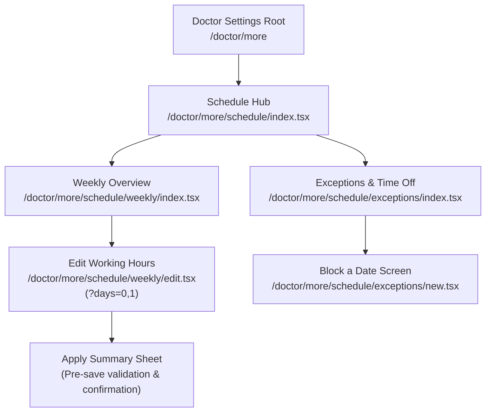
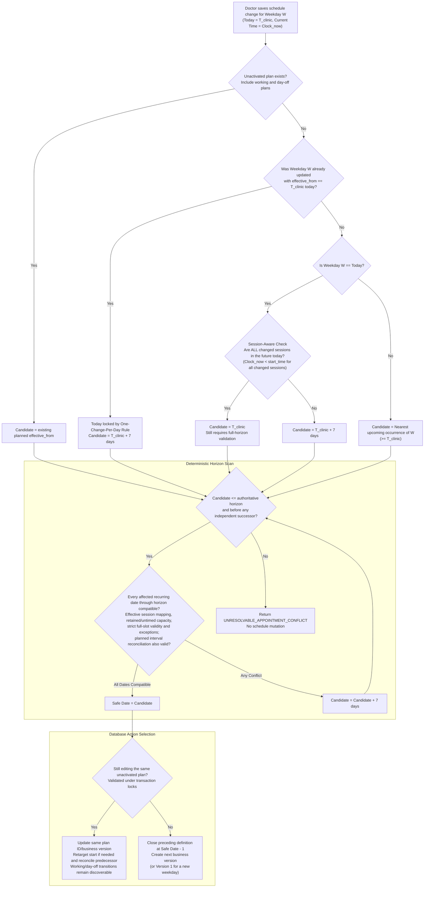
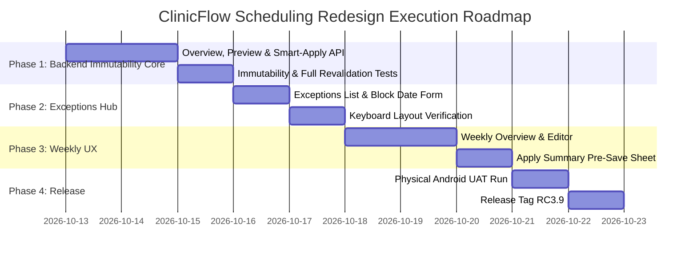

# ClinicFlow Scheduling Redesign Specification
**Document Version:** 1.2.2
**Target Release:** RC3.9 / M13
**Status:** Approved Architecture Specification
**Supersedes:** Version 1.2.1, Version 1.2.0, Version 1.1.0 & Version 1.0.0-PROPOSAL

---

## 1. Executive Summary & Historical Schedule Immutability

### 1.1 The Historical Immutability Invariant
A foundational flaw in earlier scheduling implementations was mutating an already-effective [`ScheduleDefinition`](file:///E:/ClinicFlow/clinicflow/backend/app/modules/scheduling/models.py#L25) row in-place whenever a schedule edit occurred on the current date. Doing so rewrote clinical history: an edit made at 14:00 to a schedule effective since 09:00 or 1 Oct made it appear as though the new hours had been active for the entire duration, corrupting audit trails and misrepresenting the operational rules under which prior patient appointments were booked.

In Version 1.2.2, the core invariant is absolute:

> [!IMPORTANT]
> **Core Invariant: Historical Schedule Immutability**
> Once a `ScheduleDefinition` has become effective (`effective_from <= T_clinic`), its operational definition is **permanently immutable**.
> Its session definitions, hours, capacities, and slot intervals must **never** be mutated in place.
> Editing an already-effective operational definition **always creates a new business version**, closing the preceding definition at `new_effective_date - 1 day`. If an unactivated plan already exists for that weekday, editing that plan follows Section 4.2 and preserves its business version. Adjusting the preceding definition's future `effective_to` boundary to reconcile that plan is permitted; changing its historical coverage or operational session content is not.

### 1.2 The One-Change-Per-Day Rule (Resolving Same-Day Re-Edits)
A doctor may have at most **ONE** newly-effective recurring schedule change for a given weekday on any single clinic date:
- If a schedule change is applied today ($T_{clinic}$), creating a new definition effective today, **that definition is immediately effective and therefore permanently immutable**.
- If the doctor edits that weekday again later on the same day:
  - The definition created earlier today is **NOT** mutated in-place.
  - A duplicate version with the same `effective_from` is **NOT** created (preventing database unique constraint collisions on `(doctor_id, weekday, effective_from)`).
  - The second edit **automatically defers to the next safe weekday occurrence**, starting its search at $T_{clinic} + 7\text{ days}$ and advancing further if required by the full-horizon check in Section 7.4.
  - UI Notice: *"Today's working hours were already updated. This additional change will apply from Monday, {next_occurrence_date}."*

### 1.3 Allowed In-Place Edits
In-place modification of a `ScheduleDefinition` and its child [`SessionDefinition`](file:///E:/ClinicFlow/clinicflow/backend/app/modules/scheduling/models.py#L57) rows is strictly restricted to narrow, non-historical conditions:

1. **Future Planned Definition That Has NOT Yet Become Effective (`effective_from > T_clinic`)**:
   - May be updated in-place until the clinic date reaches `effective_from`, including working/day-off transitions and later safe-date retargeting under Section 4.2. Its **business version remains unchanged**; stale-state detection uses the independent mechanism in Section 9.
   - *Rationale*: A planned future version has not yet governed active clinic operations or historical attendance. Allowing in-place edits prevents redundant version inflation (e.g. creating Version 3, 4, 5 for edits made prior to activation).
2. **Newly Created Unsaved / Preview State**:
   - In-flight client drafts and server simulation previews are freely editable prior to transactional commitment.
3. **Already-Effective Definition (`effective_from <= T_clinic`)**:
   - **Strictly Immutable operational content**. A change requires a new business version, effective either today (if no change was yet made today) or on a future safe date. An existing unactivated plan is that future business version and is edited under Section 4.2; it does not permit rewriting the effective definition's sessions.

---

## 2. The Doctor-Centric Mental Model

### 2.1 Core Paradigm Shift
The scheduling system shifts from **"Manage Versioned Schedule Definitions"** to **"My Practice Hours & Time Off"**:

| Dimension | Old Primitives (Exposed DB) | New Primitives (Doctor Mental Model) |
| :--- | :--- | :--- |
| **Weekly Pattern** | `ScheduleDefinition` (weekday, effective_from, version) | **Standard Weekly Hours** (Monday, Tuesday, etc.) |
| **Effective Date** | Manual date picker (`effective_from`) | **Automatic Application Date** (*"Applies from 19 Oct"* or *"Applies Today"*) |
| **Upcoming Plans** | Hidden in subsequent DB version rows | **Upcoming Planned Changes** (*"Current: 10–1; From 19 Oct: 11–2"*) |
| **Conflicts** | HTTP 409 Conflict with timestamp errors | **Apply Summary & Conflict Resolver** (*"Applies from 22 Oct due to 2 existing bookings"*) |
| **Ad-hoc Closures** | Monolithic bottom form with session IDs | **Dedicated Exceptions & Time-Off Hub** (*"Block a Date"*) |
| **Database Version** | Surfaced in UI (*"Version 2"*) | **Hidden Invariant** (Retained purely for internal audit, history, and FK integrity) |

### 2.2 Guiding Tenets
1. **Zero Raw Version UI**: Doctors never see version numbers, `effective_from` date pickers, or raw database timestamps during regular scheduling.
2. **Deterministic Safe Application**: The engine automatically computes the earliest safe date on which a schedule modification can take effect without orphaning or conflicting with existing patient bookings.
3. **Session-Aware Same-Day Evaluation**: Same-day application is evaluated per affected session. Changing an unstarted Evening session does not freeze merely because the Morning session has finished.
4. **Transparent "Why" Explanations**: When a change is deferred, the system explicitly communicates the reason in an **Apply Summary** card before saving.
5. **Non-Destructive Date Exceptions**: Blocking a date prevents new bookings while preserving existing appointments intact, warning staff of remaining bookings.
6. **Isolated Purpose-Built Screens**: Text-entry workflows live in compact screens where inputs sit high on the viewport, eliminating keyboard obstruction structurally.

---

## 3. Frozen Route & Screen Structure

The scheduling architecture is divided into a dedicated route tree under `mobile/app/doctor/more/schedule/`:

```
mobile/app/doctor/more/schedule/
├── _layout.tsx                     # Stack layout (headerShown: false, screen transitions)
├── index.tsx                       # Schedule Hub (Weekly summary + Exceptions card)
├── weekly/
│   ├── index.tsx                   # Weekly Schedule Overview (All 7 days + upcoming plans)
│   └── edit.tsx                    # Weekly Hours Editor (Day chips, sessions, Apply Summary)
└── exceptions/
    ├── index.tsx                   # Exceptions Hub (Upcoming blocked dates list + Unblock)
    └── new.tsx                     # Dedicated "Block a Date" Form (Compact, top-aligned)
```

### 3.1 Route Topology Diagram



### 3.2 Screen Responsibilities
- **Schedule Hub (`schedule/index.tsx`)**:
  - Top: Back control, Title: *"Schedule & Sessions"*.
  - Section 1: **Standard Weekly Hours** card showing current practice days, session times, and prominent *"Edit Weekly Hours"* button. If an upcoming schedule change is planned, an *"Upcoming Change"* banner is displayed directly below that day.
  - Section 2: **Exceptions & Time Off** card showing count of upcoming blocked dates, next 2 exceptions, and buttons: `"+ Block a Date"` and `"View All Exceptions"`.
- **Weekly Schedule Overview (`schedule/weekly/index.tsx`)**: Full 7-day breakdown with current and pending future hours.
- **Weekly Hours Editor (`schedule/weekly/edit.tsx`)**: Day chips, session cards, Day-Off toggle, and *"Review & Apply Hours"* button triggering the Apply Summary.
- **Exceptions Hub (`schedule/exceptions/index.tsx`)**: Chronological list of active upcoming blocked dates, retained booking counts, and unblock controls.
- **Block a Date Screen (`schedule/exceptions/new.tsx`)**: Short form. **Reason field sits at $Y \approx 200\text{px}$, naturally well above virtual keyboard**. Non-destructive appointment warning banner.

---

## 4. Business Versioning & Lifecycle Semantics

### 4.1 Strict Business Version Sequence
`ScheduleDefinition.version` represents the **chronological sequence of operational working hours** for a given doctor and weekday.

```text
LIFECYCLE TIMELINE EXAMPLE (Monday):

1. Initial Schedule Creation (1 Oct 2026):
   ├── ScheduleDefinition A: version=1, effective_from=2026-10-01, effective_to=NULL
   └── Hours: 10:00–13:00

2. First Edit on 12 Oct 2026 at 09:00 (Safe Date = Today 12 Oct, hours changed to 11:00–14:00):
   ├── ScheduleDefinition A closed: effective_to=2026-10-11 (Immutable history!)
   ├── ScheduleDefinition B created: version=2, effective_from=2026-10-12, effective_to=NULL
   └── Hours: 11:00–14:00 (Active immediately today)

3. Second Edit on 12 Oct 2026 at 09:20 (Doctor wants 11:30–14:30):
   ├── ScheduleDefinition B was activated today -> PERMANENTLY IMMUTABLE!
   ├── No duplicate effective_from=2026-10-12 row allowed.
   ├── Next safe candidate calculated -> Monday, 19 Oct 2026.
   ├── ScheduleDefinition B clipped: effective_to=2026-10-18.
   ├── ScheduleDefinition C created: version=3, effective_from=2026-10-19, effective_to=NULL.
   └── Hours: 11:30–14:30 (Applies from next week)

4. Re-edit on 14 Oct 2026 of Planned Change (Doctor adjusts 19 Oct plan to 12:00–15:00):
   ├── ScheduleDefinition C is NOT YET EFFECTIVE (effective_from 19 Oct > today 14 Oct).
   ├── ScheduleDefinition C is updated IN PLACE (version remains 3, sessions updated).
   └── NO redundant Version 4 row is created!
```

### 4.2 Future Planned Definition Lifecycle
A future definition (`effective_from > T_clinic`) remains a real planned lifecycle record even when it represents a **day off**, has no active sessions, or is marked inactive for working hours. Plan discovery, overview, preview-state capture and smart-apply must include it. Working-hours inactivity does not mean that the plan was deleted or superseded.

| Transition | Required lifecycle |
| :--- | :--- |
| Planned working → edited planned working | Update the same planned definition and its sessions in-place; preserve its ID and business version. |
| Planned working → planned day off | Update that same plan to no working sessions; preserve its ID/version and keep it discoverable. |
| Planned day off → planned working | Repopulate that same plan in-place; do not insert a duplicate `effective_from` row or inflate the business version. |
| Planned safe date moves later | Retarget the same unactivated plan using the atomic procedure below; do not create another business version solely because its date moved. |

For an existing plan starting on `P` and a newly calculated safe date `C > P`, use this single deterministic procedure:

1. Lock and revalidate the relevant definitions and stored-state fingerprint under Section 9. Both `P` and `C` must remain later than the authoritative clinic date. Once `P <= T_clinic`, this is an effective definition and cannot be retargeted.
2. Keep the planned definition's ID and business version; move its `effective_from` from `P` to `C` and update its child sessions in-place as required. Preserve every booked/blocked occurrence and appointment under Section 5.
3. Set the immediately preceding definition's `effective_to` to `C - 1 day`, including when that predecessor represents a day off. This adjusts a future boundary only; its operational content and historical coverage remain unchanged. With no predecessor, do not invent an earlier working schedule.
4. Preserve any independent later definition and its boundary. Retargeting must fit before that successor, must not create an invalid date interval or duplicate start date, and must not leave overlapping lifecycle periods, including planned day-off periods. A candidate that cannot satisfy these constraints is not safe; apply the horizon exhaustion rule in Section 7 if no eligible candidate remains.
5. Commit the plan, sessions and predecessor boundary together, using a write order that respects the database uniqueness and non-overlap constraints. On failure, roll back all changes. Existing appointments on dates between `P` and `C` must remain compatible with the restored predecessor's effective sessions; otherwise this retargeting candidate is unsafe.

The plan's old start date is not an independent superseding boundary after retargeting. For example, moving unactivated Version 2 from 19 Oct to 26 Oct keeps Version 2, changes the predecessor's end from 18 Oct to 25 Oct, and creates no Version 3. Section 1's immutability rule protects already-effective operational content; it does not prohibit this future-boundary reconciliation.

---

## 5. Session Occurrence & Appointment Preservation

### 5.1 Invariants for [`SessionOccurrence`](file:///E:/ClinicFlow/clinicflow/backend/app/modules/scheduling/models.py#L90)
1. **Historical Occurrences are Immutable**: Occurrences with `occurrence_date < new_effective_date` are permanently immutable. They retain snapshots of the original `SessionDefinition`.
2. **Existing Appointments Remain Anchored**: Every [`Appointment`](file:///E:/ClinicFlow/clinicflow/backend/app/modules/appointments/models.py#L23) retains its original row, `session_occurrence_id`, appointment time, financial snapshot and historical occurrence snapshot. Appointments must **never be migrated merely because a new `ScheduleDefinition` becomes effective**. Effective occupancy is a business calculation, not a rewrite of historical foreign keys.
3. **Future Materialized Occurrences ($\ge \text{new\_effective\_date}$)**:
   - **If Bookings or Blocks Exist**: The occurrence **must not be deleted or overwritten**. Compatibility means preserving bookings' effective occupancy and respecting exceptions across the affected recurring period; it does not require making old snapshots identical to the new session definition. Any appointment reference, including a cancelled appointment's historical reference, still prevents destructive cleanup of its occurrence.
   - **If No Appointment References and Status is AVAILABLE**: If an unreferenced, unblocked occurrence was pre-materialized, it may be refreshed with the new session definition's snapshots (`start_time_snapshot`, `end_time_snapshot`, `slot_interval_minutes_snapshot`, `maximum_capacity_snapshot`). Cancelled appointments do not consume capacity, but their historical references still prevent snapshot replacement.

### 5.2 Effective Occupancy Across Schedule Versions
For doctor `D`, clinic date `X` and an effective session on that date, the authoritative occupancy model is the **effective doctor/date/session business window**, not equality of `session_occurrence_id`. Active appointments anchored to retained historical occurrences that operationally belong to that effective session **must continue to consume its capacity**.

For occupancy, active means non-cancelled: `BOOKED`, `CHECKED_IN` and `COMPLETED` appointments count; `CANCELLED` appointments do not. Count each appointment once by its immutable appointment ID, including authorized override appointments. Existing capacity-override authorization and audit rules remain unchanged.

This same effective occupancy must be used by session-capacity calculation, occupied appointment-time calculation, availability, every booking validation path, scheduling conflict analysis and safe-date calculation. Timed appointments must map unambiguously to an effective session window and satisfy Section 8. An unmappable or ambiguous appointment makes the proposed schedule incompatible; it must not be dropped from the calculation.

**Example:** Patient A is booked at 10:00 on old occurrence O1. The schedule expands and a new definition/occurrence O2 becomes effective for that date. A remains attached to O1 with all original snapshots. Nevertheless, 10:00 remains occupied in the effective session and A contributes +1 to its capacity; an ordinary new booking at 10:00 must be rejected even if it would reference O2.

### 5.3 Untimed Appointments / Walk-ins
An appointment with `appointment_time = NULL`, such as a walk-in, contributes **+1 to session occupancy** but occupies **no specific timed slot**. It must participate in availability, booking capacity and preview/smart-apply safe-date capacity analysis, including after a schedule-version change.

Its session association comes from the anchored occurrence and an unambiguous correspondence to the effective session, not from an invented appointment time. If a proposed session change cannot preserve that association and capacity effect unambiguously, treat it as a conflict and defer the change. Never skip the appointment, assign a fake time, or count it in multiple sessions.

---

## 6. Non-Destructive Date Exceptions (Freezing V1 Rules)

1. **Blocking Prevents New Bookings**: When a date or session is blocked, new appointments cannot be created for that occurrence.
2. **Existing Appointments are NEVER Automatically Cancelled or Invalidated**:
   - Existing booked appointments remain **valid**, **visible**, and **untouched**.
   - The system never deletes or reschedules patients automatically without clinical human review.
3. **Transparent Warning in UI**:
   - The UI displays an informational badge: *"Date blocked. Notice: {count} patients are booked on this date. Please reschedule or cancel manually if required."*
4. **No Hard-Block on Exception Creation**: The presence of existing appointments does **NOT** prevent the doctor from blocking the date for future bookings.

---

## 7. Automatic Application-Date Algorithm

### 7.1 Algorithm Flowchart



### 7.2 Session-Aware Same-Day Feasibility
When editing today's weekday ($W == T_{clinic}.\text{weekday}$):
1. **One-Change-Per-Day Check**: If a schedule row already has `effective_from == T_clinic`, including a newly-effective day-off definition, today is locked against further modification; candidate advances to $T_{clinic} + 7\text{ days}$. An existing unactivated plan is edited under Section 4.2 instead of creating a duplicate plan.
2. **Identify Affected Sessions**:
   - Compare proposed session set $\{S_{new}\}$ with active session set $\{S_{old}\}$.
   - A session is **Affected** if added, removed, or modified in timing/capacity.
3. **Evaluate Same-Day Feasibility**:
   - Modified session: require $Clock_{now} < S_{old}.\text{start\_time}$ AND $Clock_{now} < S_{new}.\text{start\_time}$.
   - Added session: require $Clock_{now} < S_{new}.\text{start\_time}$.
   - Removed session: require $Clock_{now} < S_{old}.\text{start\_time}$ AND 0 bookings in $S_{old}$ today.
4. **Outcome**:
   - If **ALL** affected sessions satisfy these conditions, **Today ($T_{clinic}$)** is an eligible candidate, not yet a safe date. Section 7.4 must validate all affected dates through the horizon, including today.
   - If **ANY** affected session has started or completed today, or a removed session has bookings today, the initial candidate advances to **Next Week ($T_{clinic} + 7\text{ days}$)**; further conflicts may defer it again.

### 7.3 Configured Safe-Date Horizon
The search boundary $D_{horizon}$ is determined by the clinic's configured booking horizon:

$$D_{horizon} = \max(D_{configured\_horizon\_end}, D_{latest\_active\_booking} + 7\text{ days})$$

- If no clinic horizon setting is configured, use $T_{clinic} + 30\text{ days}$ as the configured-horizon term before taking the maximum. If no active booking exists, use that configured/default horizon alone.
- The latest active booking includes retained occurrences and untimed appointments for the doctor; it must not be restricted to occurrences belonging to the newest definition.
- If no candidate has a compatible affected recurring period within the horizon and lifecycle boundaries, return `UNRESOLVABLE_APPOINTMENT_CONFLICT` without mutation.

### 7.4 Full Recurring-Period Compatibility
A recurring definition affects every matching weekday from its `effective_from` until it is superseded. A **first conflict-free occurrence is not necessarily a safe recurring effective date**.

For each candidate effective date `C`:

1. Determine the authoritative horizon `H` under Section 7.3 from the current state.
2. Examine every matching affected weekday occurrence `D` where `C <= D <= H`. If an independent later definition supersedes the proposed definition, its start is an exclusive upper boundary for this proposed period; its own coverage must not be altered. An edited plan's former start date is not such a boundary.
3. Evaluate all relevant active appointments on every affected date using effective session mapping, session-wide capacity, strict slot validity, retained historical-occurrence occupancy and untimed walk-in capacity. Respect existing date/session exceptions. For retargeted plans, also validate the predecessor coverage restored between the old and new planned start dates under Section 4.2.
4. If **any** relevant appointment is incompatible, or the interval/exception constraints fail, `C` is unsafe even if the occurrence on `C` itself is empty.
5. Advance `C` by seven days and repeat. Accept the earliest eligible candidate only when **all** affected dates through `H` (or the independent superseding boundary) are compatible; otherwise stop at exhaustion under Section 7.3.

Preview and authoritative smart-apply use this same evaluation. Smart-apply recomputes the horizon and compatibility against live state under the concurrency protections in Section 9; it cannot rely on the preview's earlier scan. Examples showing application today or next week assume that the remaining affected recurring dates are also compatible.

**Example:** Monday 19 Oct has no appointments, but Monday 26 Oct has a retained 10:00 booking incompatible with a proposed 11:00 start. With a horizon including 2 Nov and no independent superseding definition, neither 19 Oct nor 26 Oct is safe. The earliest safe candidate is 2 Nov only if every affected date from 2 Nov through the horizon is compatible.

---

## 8. Appointment Conflict Rules & Strict Slot Modulo

For an effective/proposed session $S_{new}$ with window $[t_{start}, t_{end})$, interval $I_{slot}$ and session capacity $C$, an existing appointment conflicts if ANY condition below holds. Evaluate occupancy across all relevant retained occurrences under Section 5, not only the new session occurrence.

1. **Boundary / Full-Interval Violation (timed appointments)**: $t_{appt} < t_{start}$ OR $t_{appt} + I_{slot} > t_{end}$. A slot starting at the end boundary is therefore invalid.
2. **Capacity Deficit**: Total active appointments mapped to $S_{new}$ on date $D > C$, including untimed walk-ins and retained bookings. Capacity is **session-wide**, not an allowance per timed slot.
3. **Strict Slot-Grid Misalignment**:
   $$(t_{appt} - t_{start}) \pmod{I_{slot}} \ne 0$$
   This check applies to timed appointments only. *Strict V1 Rule: Zero fractional or offset slot tolerances; no rounding into a valid slot.*
4. **Session Removal / Invalid Mapping**: An operational session is removed while active appointments still require it, or an appointment cannot be mapped unambiguously to a compatible effective session. Merely replacing a definition's row ID is not operational session removal; Section 5 preserves the original anchor and effective occupancy.

The single authoritative predicate for a valid bookable timed slot is:

```text
slot_start >= session_start
AND (slot_start - session_start) % slot_interval == 0
AND slot_start + slot_interval <= session_end
```

Use exact time arithmetic with consistent units. Booking, availability slot generation, preview conflict analysis and smart-apply safe-date analysis must use identical semantics. For a 10:00–10:50 session with a 30-minute interval, **10:00 is valid; 10:30 is invalid** because 10:30–11:00 exceeds the session boundary. An existing 10:30 appointment therefore conflicts with that proposed session even though its start is inside the window and aligned to the grid.

Untimed appointments are exempt from timed-slot boundary/modulo checks, but not from session mapping or capacity. They do not mark a particular slot occupied and must never be assigned a synthetic time. Authorized overrides retain their existing rules; schedule edits do not silently grant new overrides or erase existing occupancy.

---

## 9. Proposal Token Security & Authoritative Smart-Apply Transaction

### 9.1 Server-Signed Proposal Token (Advisory Preview)
`POST preview-impact` generates a cryptographically server-signed (HMAC-SHA256) `proposal_token` with a 10-minute expiry. The preview response is **strictly advisory**.

Two independent checks are required:

- **`payload_hash`** binds the token to what the client submitted. It does **not** prove that the stored schedule remained unchanged after preview.
- **`stored_state_fingerprint`**, captured per affected weekday in `expected_states`, binds the token to the authoritative stored schedule state observed during preview. Prefer a canonical server-computed SHA-256 fingerprint. A persisted `edit_revision` may replace this mechanism only if explicitly justified later; it must be independent of `ScheduleDefinition.version`. **Never increment the business version merely to detect an in-place future-plan edit.**

The canonical stored state must cover the relevant current and upcoming definitions, including day-off plans, explicit absence of a definition, IDs, business versions, weekday, effective boundaries and working/inactive state. It must include relevant child-session IDs, names, start/end times, slot intervals, capacities, active flags and display order. Include any predecessor/successor state used to determine the proposal's lifecycle boundaries. Use deterministic ordering and normalized field representations; omitting an inactive plan or hashing only the proposal is insufficient.

The fingerprint protects stored schedule content. Live appointment and exception changes still require the complete re-evaluation and safe-date comparison below. Clinic/doctor binding, proposal payload hash, purpose-separated token security and expiry remain required alongside this independent stale-state check. Fingerprint values in the following example are illustrative.

**Token Claims:**
```json
{
  "clinic_id": "019485c2-1234-789a-bcde-000000000001",
  "doctor_id": "019485c2-1234-789a-bcde-000000000002",
  "payload_hash": "e3b0c44298fc1c149afbf4c8996fb92427ae41e4649b934ca495991b7852b855",
  "weekdays": [0, 3],
  "expected_states": {
    "0": {
      "active_id": "019485c2-1234-789a-bcde-000000000010",
      "active_version": 1,
      "upcoming_id": null,
      "upcoming_version": null,
      "stored_state_fingerprint": "sha256:aaaaaaaaaaaaaaaaaaaaaaaaaaaaaaaaaaaaaaaaaaaaaaaaaaaaaaaaaaaaaaaa",
      "calculated_safe_date": "2026-10-19"
    },
    "3": {
      "active_id": "019485c2-1234-789a-bcde-000000000030",
      "active_version": 1,
      "upcoming_id": null,
      "upcoming_version": null,
      "stored_state_fingerprint": "sha256:bbbbbbbbbbbbbbbbbbbbbbbbbbbbbbbbbbbbbbbbbbbbbbbbbbbbbbbbbbbbbbbb",
      "calculated_safe_date": "2026-10-22"
    }
  },
  "evaluated_at": "2026-10-12T14:30:00Z",
  "exp": 1791816000
}
```

### 9.2 Authoritative 10-Step Smart-Apply Transaction
During `PUT smart-apply`, the final transaction executes the authoritative business logic:

After locking the relevant schedule rows, recompute/read the authoritative stored state and compare its fingerprint (or justified independent revision) with the preview's expected state. A difference returns **HTTP 409 `STALE_SCHEDULE_PREVIEW`**, rolls back and applies nothing, even when IDs, business versions and the calculated safe date are unchanged. Protect this comparison through commit against competing schedule/session writes; row locking must be part of the shared scheduling/booking concurrency protocol, not a substitute for it.

```mermaid
sequenceDiagram
    autonumber
    actor Client as Mobile Client
    participant API as Smart-Apply Endpoint
    participant DB as PostgreSQL 17

    Client->>API: PUT /schedule/smart-apply (proposal, proposal_token)
    activate API
    API->>API: 1. Verify HMAC signature and token expiration
    API->>API: 2. Verify clinic_id and doctor_id
    API->>API: 3. Verify SHA-256 payload_hash matches submitted body

    API->>DB: BEGIN TRANSACTION
    API->>DB: 4. Lock relevant current/upcoming definitions, including day-off plans and lifecycle boundaries
    API->>API: 5. Recompute stored-state fingerprint; compare expected fingerprint, IDs and business versions
    API->>DB: 6. Rerun full-horizon appointment & exception analysis, including retained/untimed occupancy
    API->>API: 7. Recompute safe effective dates and validate planned interval reconciliation
    API->>API: 8. Compare computed effective dates with token's calculated_safe_date

    alt State Mismatch or Timeline Divergence
        API->>DB: 9. ROLLBACK TRANSACTION
        API-->>Client: HTTP 409 STALE_SCHEDULE_PREVIEW
        Client-->>Client: Re-fetches preview automatically; displays updated timeline
    else State Matches Preview Exactly
        API->>DB: 10. Create next business version OR update/retarget same future plan; reconcile predecessor atomically
        API->>DB: COMMIT TRANSACTION
        API-->>Client: HTTP 200 OK: Updated Weekly Overview
    end
    deactivate API
```

---

## 10. Backend API Redesign

### 10.1 `GET /api/v1/doctors/{doctor_id}/schedule/overview`
Returns current hours and pending upcoming changes for all 7 days.

Upcoming changes include planned day-off definitions with no active sessions; they remain visible/editable lifecycle records under Section 4.2.

**Response (200 OK):**
```json
{
  "doctor_id": "019485c2-1234-789a-bcde-000000000002",
  "effective_on": "2026-10-12",
  "days": [
    {
      "weekday": 0,
      "weekday_name": "Monday",
      "current": {
        "schedule_definition_id": "019485c2-1234-789a-bcde-000000000010",
        "effective_from": "2026-10-01",
        "effective_to": "2026-10-18",
        "version": 1,
        "sessions": [
          {
            "session_name": "Morning",
            "start_time": "10:00:00",
            "end_time": "13:00:00",
            "slot_interval_minutes": 15,
            "maximum_capacity": 10
          }
        ]
      },
      "upcoming": {
        "schedule_definition_id": "019485c2-1234-789a-bcde-000000000020",
        "effective_from": "2026-10-19",
        "effective_to": null,
        "version": 2,
        "sessions": [
          {
            "session_name": "Morning",
            "start_time": "11:00:00",
            "end_time": "14:00:00",
            "slot_interval_minutes": 15,
            "maximum_capacity": 10
          }
        ]
      }
    }
  ]
}
```

### 10.2 `POST /api/v1/doctors/{doctor_id}/schedule/preview-impact`
Generates the server-signed `proposal_token` and per-day timeline.

**Request:**
```json
{
  "weekdays": [0, 3],
  "sessions": [
    {
      "session_name": "Morning",
      "start_time": "11:00:00",
      "end_time": "13:00:00",
      "slot_interval_minutes": 15,
      "maximum_capacity": 8,
      "active": true,
      "display_order": 0
    }
  ]
}
```

**Response (200 OK):**
```json
{
  "proposal_token": "eyJhbGciOiJIUzI1NiIsInR5cCI6IkpXVCJ9...",
  "evaluated_at": "2026-10-12T14:30:00Z",
  "impacts": [
    {
      "weekday": 0,
      "weekday_name": "Monday",
      "applies_from": "2026-10-19",
      "reason": "Today's clinic hours have already started.",
      "existing_appointments_count": 0,
      "conflict_detected": false
    },
    {
      "weekday": 3,
      "weekday_name": "Thursday",
      "applies_from": "2026-10-22",
      "reason": "2 existing appointments booked on 15 Oct fall outside proposed hours (10:00 - 10:30 AM).",
      "existing_appointments_count": 2,
      "conflict_detected": true
    }
  ]
}
```

### 10.3 `PUT /api/v1/doctors/{doctor_id}/schedule/smart-apply`
Executes atomic schedule updates under row lock and token verification.

**Request:**
```json
{
  "proposal_token": "eyJhbGciOiJIUzI1NiIsInR5cCI6IkpXVCJ9...",
  "weekdays": [0, 3],
  "sessions": [ ... ]
}
```

---

## 11. Edge-Case Decision Table (All 18 Scenarios)

All application dates below are conditional on Section 7's full-horizon validation; a later conflicting recurrence may defer a change beyond next week. Where a future plan already exists, Section 4.2's same-plan lifecycle takes precedence over creating another version.

| # | Edge Case Scenario | System Action & Database Lifecycle | Doctor UI Feedback |
| :--- | :--- | :--- | :--- |
| **1** | Monday before session, no appointments | Closes prior version (`effective_to = yesterday`). Creates **Version 2 effective Today ($T_{clinic}$)**. | *"Applies immediately today."* |
| **2** | Monday before session, appointments exist | If all affected recurring dates are compatible $\rightarrow$ **Version 2 effective Today**, retaining original anchors and effective occupancy. Otherwise defer to the next fully safe Monday. | *"Applies from {date} to protect existing bookings."* |
| **3** | Monday during clinic hours | Ongoing session immutable; **Version 2 effective Next Monday** ($T_{clinic} + 7\text{d}$). | *"Applies next Monday. Ongoing session cannot be modified."* |
| **4** | Monday after clinic hours | Today's clinic done; **Version 2 effective Next Monday** ($T_{clinic} + 7\text{d}$). | *"Applies next Monday (19 Oct)."* |
| **5** | Mid-day: Edit Evening only (17:00–20:00) at 14:00 | Evening unstarted & unconflicted $\rightarrow$ **Version 2 effective Today**. Morning historical definition closed at yesterday. | *"Evening session updated for today; Morning unchanged."* |
| **6** | Booking exists in only one session | Evaluated per session. Session with booking restricts only its own boundaries. | Split timeline in Apply Summary |
| **7** | Shortening hours around an appointment | Defers to the earliest candidate whose entire affected recurring period satisfies new boundaries and full-slot validity. | *"Applies from 22 Oct due to 1 appointment on 15 Oct at 10:15 AM."* |
| **8** | Increasing hours | If the full recurring period is compatible, creates a version effective immediately or on the nearest safe occurrence. Retained bookings still occupy their times and consume effective capacity. | *"Applies from {date}."* |
| **9** | Reducing capacity below booked count | Defers past all affected dates where total effective occupancy, including retained appointments and untimed walk-ins, exceeds new capacity. | *"Applies from {date}. Earlier dates already have {N} patients."* |
| **10** | Changing slot duration with bookings | Requires grid alignment **and a full interval ending within the session**. Defers until every affected recurrence through the horizon is compatible; an empty first occurrence is insufficient. | *"New pacing applies from {date}."* |
| **11** | Disabling a weekday with appointments | Defers closure until after final booked date. | *"Cannot disable until {date} without rescheduling {N} patients."* |
| **12** | Adding a new weekday | Creates Version 1 effective on nearest upcoming occurrence ($\ge T_{clinic}$). | *"Applies from {next_occurrence_date}."* |
| **13** | Multi-day edit with mixed histories | Evaluates each day independently; creates respective next versions atomically. | Consolidated multi-day table |
| **14** | Future schedule change already planned | Update the same plan ID/business version in-place. If its safe date moves later, retarget that unactivated plan and reconcile the predecessor atomically without overlaps or duplicate versions. | *"Updated upcoming schedule change starting {date}."* |
| **15** | Blocking a date with existing appointments | Blocks new bookings; existing appointments preserved; warning banner shown. | *"Date blocked. Notice: {N} patients require rescheduling."* |
| **16** | User edits schedule twice on same day | Version created earlier today is immutable. Second edit creates **Version 3 effective on the next fully safe Monday**, no earlier than $T_{clinic} + 7\text{d}$. | *"Today's working hours were already updated. This change applies from {date}."* |
| **17** | User edits before planned change activates | Working → working, working → day off and day off → working all update the same discoverable planned ID/business version; no duplicate start-date row. | *"Updated your upcoming schedule change."* |
| **18** | Concurrent edits from two devices | Stored-state fingerprint/revision mismatch aborts with `STALE_SCHEDULE_PREVIEW`, including in-place future-plan edits whose business version and safe date are unchanged. | *"Schedule was updated by another user. Reloading."* |

---

## 12. Automated Test Matrix

### 12.1 Historical Immutability & Lifecycle Tests
1. `test_active_schedule_edit_creates_new_version_and_preserves_history`:
   - Existing Monday effective 1 Oct (10:00–13:00).
   - Change on 12 Oct to 11:00–14:00.
   - Assert original row unchanged with `effective_to = 2026-10-11` and `version = 1`.
   - Assert new row created with `effective_from = 2026-10-12` and `version = 2`.
2. `test_appointments_before_edit_retain_original_session_references`:
   - Assert appointments booked on 5 Oct point to original `session_occurrence_id` and snapshots.
3. `test_second_same_day_edit_defers_to_next_week_and_preserves_first_version`:
   - First edit at 09:00 creates Version 2 effective today (12 Oct).
   - Second edit at 09:20 creates Version 3 effective next Monday (19 Oct).
   - Assert Version 2 remains untouched and no duplicate 12 Oct row is created.
4. `test_future_planned_version_edited_in_place_without_version_inflation`:
   - Planned Version 2 effective 26 Oct edited on 16 Oct.
   - Assert Version 2 updated in-place; no Version 3 created.
5. `test_same_day_safe_application_creates_new_version_effective_today`:
   - Monday 09:00 edit with 0 appointments creates Version 2 effective today, closing Version 1 at yesterday.

### 12.2 Concurrency, Stale Preview & Rollback Tests
6. `test_smart_apply_catches_changed_booking_condition_and_returns_stale_preview`:
   - Preview generated. New appointment booked on candidate date.
   - Smart-apply executes full re-evaluation; detects new appointment conflict; aborts with 409.
7. `test_smart_apply_catches_concurrent_schedule_edit_and_aborts`:
   - Preview generated. Another user commits schedule update.
   - Smart-apply locks the relevant rows, detects stored-state fingerprint/revision or identity/version mismatch, and aborts with 409.
8. `test_smart_apply_catches_exception_created_during_review`:
   - Date blocked during review. Smart-apply detects exception; aborts with 409.
9. `test_smart_apply_transaction_rollback_preserves_all_original_data`:
   - Simulates exception during apply; proves database rolls back completely.
10. `test_smart_apply_full_conflict_scan_identical_to_preview_when_unchanged`:
    - Proves full authoritative scan succeeds and applies cleanly when database state is unchanged.

### 12.3 Core Edge-Case Coverage (Cases 1–18)
- Automated coverage for each scenario in the Edge-Case Decision Table.

### 12.4 v1.2.2 Clarification Regression Requirements
These are required implementation tests, not evidence that the current implementation already passes. Each applicable case must exercise preview and authoritative smart-apply, and assert persisted state rather than source text.

1. **Retained occupancy after activation**: Apply a compatible new schedule version with an existing appointment on/after its start. Assert the original appointment row, occurrence FK, time and financial/occurrence snapshots are unchanged, while effective availability still includes its occupancy.
2. **Retained timed-slot protection**: Patient A retains 10:00 on the old occurrence. A normal booking for patient B at 10:00 through the new effective session must fail; historical occurrence-ID differences must not bypass the occupied time.
3. **Retained session-capacity protection**: Fill the new effective session's capacity using retained appointments, then attempt a normal booking at a different, otherwise valid free time. It must fail on session capacity. Cancelled appointments must not consume capacity.
4. **Untimed walk-in capacity**: Include `appointment_time = NULL` appointments when previewing/applying a capacity reduction and calculating effective availability. They each count once, occupy no timed slot, retain their original anchors and cannot be silently omitted when session mapping changes.
5. **Final partial-slot parity**: For 10:00–10:50 at 30-minute intervals, 10:00 is valid and 10:30 is invalid in slot generation/booking and preview/apply conflict analysis. A retained 10:30 booking must defer the proposed change. Also cover exact-fit end boundaries; no rounding or fractional tolerance.
6. **Stale in-place future-plan edit**: Generate two previews against the same future plan. Apply one change without changing the business version or safe date. Applying the other preview must return 409 `STALE_SCHEDULE_PREVIEW` because stored content changed, and must not overwrite the first result. The second submitted payload must still match its own `payload_hash`.
7. **Planned working → day off → working**: Apply both transitions before activation. Assert the plan remains discoverable in overview/preview, its ID/business version remain constant, and no duplicate start-date row is created.
8. **Later planned safe date**: Existing bookings force the edited plan's date later. Assert the same plan ID/business version is retargeted, its predecessor ends at the new start minus one day, intervening retained bookings stay compatible, no periods overlap, and no historical snapshots/FKs change. A failure must roll back both interval changes.
9. **Later recurrence invalidates an empty candidate**: First candidate date is empty; a later matching weekday within the horizon has an incompatible retained booking. Preview/apply must reject that earlier candidate and defer beyond the conflicting recurrence.
10. **Whole-period success**: Accept a candidate only when every affected matching date through the authoritative horizon is compatible. Cover retained timed bookings, untimed capacity, a configured/default horizon extended by the latest active booking, an independent superseding boundary, and exhaustion with no eligible safe date. Re-evaluation must detect a new conflicting later booking committed after preview.

---

## 13. Physical UAT Matrix

| Step | Test Action | Expected Device Behavior |
| :--- | :--- | :--- |
| **UAT-SCHED-01** | Open Schedule Settings | Shows clean Hub: Weekly Schedule Summary and Exceptions card. No giant form. |
| **UAT-SCHED-02** | Edit Monday hours on Monday morning with 1 booking at 10:15 | Apply Summary states: *"Applies from next Monday (19 Oct) due to 1 existing appointment."* |
| **UAT-SCHED-03** | Mid-day test: At 14:00, edit Evening hours (17:00–20:00) | Apply Summary shows: *"Applies today (12 Oct) for Evening session."* |
| **UAT-SCHED-04** | Select Mon + Tue and save | Apply Summary displays per-day rows; saving succeeds atomically. |
| **UAT-SCHED-05** | Tap "Block a Date" | Opens short screen. Focused Reason input sits comfortably in upper half above keyboard. No overlap. |
| **UAT-SCHED-06** | Block a date with existing bookings | Date blocked. Warning banner shows remaining bookings. Existing bookings still visible on Today screen. |

---

## 14. Exact Files Likely to Change

### Backend
- [`backend/app/modules/scheduling/models.py`](file:///E:/ClinicFlow/clinicflow/backend/app/modules/scheduling/models.py) *(Read-only, no schema changes required)*
- [`backend/app/modules/scheduling/schemas.py`](file:///E:/ClinicFlow/clinicflow/backend/app/modules/scheduling/schemas.py) *(Add `ScheduleOverviewResponse`, `ScheduleImpactRequest`, `ScheduleImpactResponse`, `SmartScheduleApplyRequest`)*
- [`backend/app/modules/scheduling/service.py`](file:///E:/ClinicFlow/clinicflow/backend/app/modules/scheduling/service.py) *(Implement `get_schedule_overview`, `preview_schedule_impact`, `smart_apply_schedule`, and immutability engine)*
- [`backend/app/modules/scheduling/router.py`](file:///E:/ClinicFlow/clinicflow/backend/app/modules/scheduling/router.py) *(Expose overview, preview, and smart-apply routes)*
- [`backend/tests/integration/test_schedule_api.py`](file:///E:/ClinicFlow/clinicflow/backend/tests/integration/test_schedule_api.py) *(Add integration test suite)*

### Mobile
- [`mobile/src/api/api.ts`](file:///E:/ClinicFlow/clinicflow/mobile/src/api/api.ts) *(Add RTK Query hooks)*
- [`mobile/app/doctor/more/schedule/_layout.tsx`](file:///E:/ClinicFlow/clinicflow/mobile/app/doctor/more/schedule/_layout.tsx) *(Stack layout)*
- [`mobile/app/doctor/more/schedule/index.tsx`](file:///E:/ClinicFlow/clinicflow/mobile/app/doctor/more/schedule/index.tsx) *(Schedule Hub)*
- [`mobile/app/doctor/more/schedule/weekly/index.tsx`](file:///E:/ClinicFlow/clinicflow/mobile/app/doctor/more/schedule/weekly/index.tsx) *(Weekly Overview)*
- [`mobile/app/doctor/more/schedule/weekly/edit.tsx`](file:///E:/ClinicFlow/clinicflow/mobile/app/doctor/more/schedule/weekly/edit.tsx) *(Weekly Editor with Apply Summary)*
- [`mobile/app/doctor/more/schedule/exceptions/index.tsx`](file:///E:/ClinicFlow/clinicflow/mobile/app/doctor/more/schedule/exceptions/index.tsx) *(Exceptions Hub)*
- [`mobile/app/doctor/more/schedule/exceptions/new.tsx`](file:///E:/ClinicFlow/clinicflow/mobile/app/doctor/more/schedule/exceptions/new.tsx) *(Block Date Screen)*
- [`mobile/src/features/scheduling/types.ts`](file:///E:/ClinicFlow/clinicflow/mobile/src/features/scheduling/types.ts) *(Client types)*

---

## 15. Implementation Roadmap


